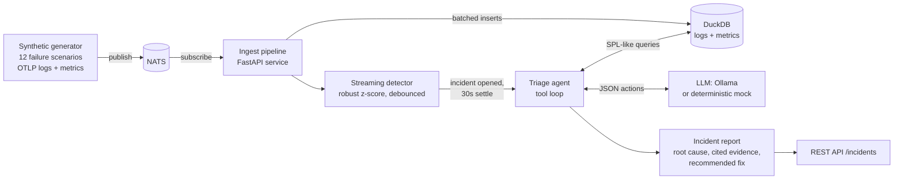

# IncidentPilot: Agentic Triage on a Streaming Event Platform


*Demo: inject a failure, get the agent's cited incident report. A paced (~60 s) replay of the real
`incidentpilot simulate --scenario bad_deploy` output; regenerate with `scripts/render_demo_gif.py`.
Try it yourself with `make simulate SCENARIO=bad_deploy`.*

An AI agent that watches a live stream of machine data, investigates anomalies with
search tools, and writes an evidence-backed incident summary with a recommended fix.
It runs on a local Kubernetes cluster (kind + Helm), and the whole thing also works
offline with a deterministic mock LLM.

## Architecture



Everything in the middle (ingest, detector, agent, API, DuckDB) runs as one pod on kind; NATS, the generator
Job and the optional Ollama are separate workloads in the same Helm release.

## Evaluation results

Reproduce with `make eval` (offline, mock LLM, deterministic). Summary over **20 scripted incidents**
(all 12 scenarios; different services, seeds and start times) plus 3 healthy runs:

| Metric | Result |
| --- | --- |
| Root-cause accuracy (category) | **100%** (20/20) |
| Root-service accuracy | 100% |
| Incidents detected | 20/20 |
| Reports with cited evidence (>=2 queries) | all |
| False alarms on healthy traffic | 0 |
| Mean / p95 time-to-diagnosis | 51 s / 60 s (event time) |
| Mean agent steps (tool calls) | 8.3 |

Time-to-diagnosis = detection delay (20-30 s) + a fixed 30 s settle window + agent compute (about 0.03 s, 8-9 queries).
So it is dominated by the deliberate settle window, not by the agent.

<details><summary>Per-incident results</summary>

| Case | Injected | Diagnosed | Service | Detected after (s) | Diagnosis after (s) | Steps | Evidence |
| --- | --- | --- | --- | --- | --- | --- | --- |
| leak-checkout | `memory_leak` | `memory_leak` | checkout | 30 | 60 | 8 | 5 |
| leak-auth | `memory_leak` | `memory_leak` | auth | 30 | 60 | 8 | 5 |
| deploy-payments | `bad_deploy` | `bad_deploy` | payments | 20 | 50 | 9 | 7 |
| deploy-checkout | `bad_deploy` | `bad_deploy` | checkout | 20 | 50 | 9 | 7 |
| stuffing-auth | `credential_stuffing` | `credential_stuffing` | auth | 20 | 50 | 8 | 5 |
| dbpool-checkout | `db_pool_exhaustion` | `db_pool_exhaustion` | checkout | 20 | 50 | 8 | 5 |
| dbpool-payments | `db_pool_exhaustion` | `db_pool_exhaustion` | payments | 20 | 50 | 8 | 5 |
| disk-inventory | `disk_full` | `disk_full` | inventory | 20 | 50 | 8 | 5 |
| disk-search | `disk_full` | `disk_full` | search | 20 | 50 | 8 | 5 |
| saturation-inventory | `dependency_saturation` | `dependency_saturation` | inventory | 20 | 50 | 9 | 6 |
| saturation-payments | `dependency_saturation` | `dependency_saturation` | payments | 20 | 50 | 9 | 6 |
| cert-payments | `cert_expiry` | `cert_expiry` | payments | 20 | 50 | 9 | 6 |
| cert-inventory | `cert_expiry` | `cert_expiry` | inventory | 20 | 50 | 9 | 6 |
| config-search | `config_change` | `config_change` | search | 20 | 50 | 8 | 6 |
| config-payments | `config_change` | `config_change` | payments | 20 | 50 | 8 | 6 |
| backlog-inventory | `queue_backlog` | `queue_backlog` | inventory | 20 | 50 | 8 | 5 |
| cache-redis | `cache_failure` | `cache_failure` | cache | 20 | 50 | 8 | 5 |
| spike-gateway | `traffic_spike` | `traffic_spike` | gateway | 20 | 50 | 8 | 5 |
| dns-checkout | `dns_failure` | `dns_failure` | checkout | 20 | 50 | 8 | 5 |
| dns-gateway | `dns_failure` | `dns_failure` | gateway | 20 | 50 | 8 | 5 |

</details>

**Read this table honestly:** the mock LLM is a rule-based investigator whose signatures were written alongside the
generator, so 100% shows the pipeline, tools and harness work end to end; it is not a claim about LLM
quality. Use `incidentpilot eval --llm ollama` to measure a real local model with the same harness.
There is also **no measured manual baseline** in this repo: any "minutes vs seconds" comparison with a human
on-call would need that data collected separately.

## How this maps to a customer engagement

| Engagement stage | What this project provides |
| --- | --- |
| **Discovery (week 0-1)** | Agree the top recurring incident types and map them to scenarios in `generator.py` and runbooks in `playbook.py`; pick the signals (logs, metrics, deploy/config events) already available. |
| **Proof of value (week 1-3)** | Replace the generator with the customer's OTLP export (NATS/Kafka subject or `POST /ingest`). Replay historical incidents through `incidentpilot eval` to get an accuracy and time-to-diagnosis number on *their* data, "tangible proof" before anything touches production. |
| **Pilot (week 3-6)** | Run in the customer's cluster via the Helm chart in shadow mode: reports land on `/incidents`, on-call compares them to what actually happened. Swap the mock for a local/private LLM (Ollama) so no telemetry leaves the environment. |
| **Scale-out** | The `Bus` and `Store` interfaces are small: Redpanda/Kafka in place of NATS, a columnar store or Splunk/OpenSearch behind the query layer, persistent volumes, multiple consumers (single-writer DuckDB is the current limit). |

Why it lands with an enterprise audience: event-driven (decoupled producers and consumers), Kubernetes-native,
air-gappable (local LLM), every claim is traceable to a re-runnable query, and the value is measured by a
repeatable benchmark rather than a chat demo.

## Summary line

> Built an agentic incident-triage system on an event-driven pipeline (Kubernetes, NATS, DuckDB, LLM tool use);
> reached 100% root-cause accuracy across 20 simulated incidents (offline, mock LLM), diagnosing each in
> about 51 s of event time with <0.1 s of agent compute.

(The transport is NATS, not Redpanda, and no manual baseline was measured, so the line above avoids claiming either.)

## Features

- **Synthetic event generator**: multi-service (7 services) OpenTelemetry-format logs and
  metrics with 12 injectable failure scenarios: memory leak, bad deploy, credential
  stuffing, DB pool exhaustion, disk full, dependency saturation, TLS cert expiry,
  config change, queue backlog, cache failure, traffic spike, DNS failure. Deterministic per seed.
- **Event-driven pipeline**: records flow over NATS (or an in-process bus) into DuckDB while a
  streaming robust-z-score detector (median/MAD per service and signal, debounced) opens incidents.
- **Tool-using agent**: investigates through an SPL-like query language (`search`, `stats`,
  `timechart`, `top`, `sort`, `head`, `where`, `fields`), correlates deploys, config changes,
  metrics, error text and peers, and emits a structured report in which every finding cites an evidence id
  (and the exact, re-runnable query behind it).
- **Evaluation harness**: 20 scripted incidents (all 12 scenarios, varied services/seeds/start times)
  plus healthy runs; scores root-cause accuracy, root-service accuracy, evidence citation,
  false alarms and time-to-diagnosis. Fully offline.
- **Deployment**: Dockerfile, `docker-compose.yml`, Helm chart, and `make demo` for kind.

## Quick start (no services needed)

```bash
make install                 # creates .venv, installs the package + pytest
make test                    # 92 tests, ~30s
make simulate SCENARIO=memory_leak   # inject a failure, print the agent's incident report
make eval                    # score the agent on 20 incidents (writes eval_results.json)
```

Scenarios: `memory_leak bad_deploy credential_stuffing db_pool_exhaustion disk_full
dependency_saturation cert_expiry config_change queue_backlog cache_failure traffic_spike dns_failure`.

Example of what `make simulate SCENARIO=credential_stuffing` prints (abridged):

```
# [HIGH] Credential-stuffing attack on login in auth  (INC-0001)
**Root cause:** `credential_stuffing` in **auth** (confidence 98%)
- [E2] Top message in auth: "login failed: invalid credentials" (1290x)
- [E7] 1290 errors from 3 distinct IPs and 1149 distinct users
## Recommended fix
1. Block or rate-limit the offending source IPs at the edge/WAF. ...
```

## Run the full stack

**kind + Helm (one command).** Needs `docker`, `kind`, `kubectl`, `helm`:

```bash
make demo                    # SCENARIO=cert_expiry make demo to pick another failure
make demo-down               # delete the cluster
```

It creates a kind cluster, builds and loads the image, installs the chart (NATS, API/agent,
generator Job), replays the scenario at 20x speed and prints the agent's report. The API is also
exposed on <http://localhost:8000> (`/incidents`, `/incidents/{id}/report`, `POST /query`).

**docker compose** (NATS + API + generator, no Kubernetes):

```bash
docker compose --profile generate up --build
curl localhost:8000/incidents
```

**Plain Python API** (in-process bus; feed it through `POST /ingest`):

```bash
make serve    # API on :8000; POST OTLP records to /ingest, POST /finish, then GET /incidents
```

### Using a real local LLM

Set `INCIDENTPILOT_LLM=ollama` (plus `OLLAMA_URL`, `OLLAMA_MODEL`; see `.env.example`), or in Helm
`--set llm.backend=ollama --set llm.ollama.enabled=true` and `ollama pull` the model in the pod.
`incidentpilot eval --llm ollama` scores a real model with the same harness. If Ollama is
unreachable the agent transparently falls back to the mock (the report's `llm` field says so).

## Components and Kubernetes layout

| Module | Role |
| --- | --- |
| `generator.py`, `otel.py` | Scenario-driven telemetry; flat rows <-> OTLP/JSON log and gauge records |
| `bus.py` | `MemoryBus` and `NatsBus` behind one tiny interface |
| `store.py`, `query.py` | DuckDB tables `logs`/`metrics`; SPL-like language compiled to parameterised SQL |
| `detector.py`, `pipeline.py` | Windowed robust-z detector; incident grouping, settle/cooldown, agent dispatch |
| `agent.py`, `llm.py`, `playbook.py` | Tool loop, `MockLLM` / `OllamaLLM` / fallback, known failure signatures + fixes |
| `evaluation.py`, `cli.py`, `api.py`, `runtime.py` | Eval harness, CLI, FastAPI service, bus consumer |

Kubernetes layout (`deploy/helm/incidentpilot`): `nats` Deployment+Service, `api` Deployment
(FastAPI + consumer + agent + DuckDB) + NodePort Service, `generator` Job (waits for the API to be healthy,
then replays a scenario), optional `ollama`.

## Key design decisions

- **NATS over Redpanda**: single tiny container, trivial in kind. Core NATS has no replay, so the
  generator Job waits for the API's subscription to exist before publishing. The `Bus` interface is
  small enough to swap in Redpanda/Kafka.
- **Event time everywhere**: detector windows, incident settle/cooldown and the agent's query window
  all use record timestamps, so results do not depend on replay speed or batching (a test asserts
  identical reports for batch sizes 3, 97 and 5000). The agent can only see data up to its dispatch time.
- **Detector**: per (service, signal) median/MAD (floored with baseline stdev and relative/absolute minimums),
  2 consecutive flagged windows to confirm, flagged windows never enter the baseline so slow ramps are not
  absorbed. 0 false alarms across 80 healthy seeds; anomalies confirmed 20-30s after injection.
- **Query language is a compiler, not string-concatenated SQL**: identifiers are validated against the schema
  or the previous stage's columns, every literal is a bound parameter, and results are capped at 500 rows.
  `timechart ... by` returns long-form rows rather than a pivot.
- **Mock LLM is a real investigator, not a lookup of ground truth**: it speaks the same JSON action protocol
  as Ollama, issues queries, parses their results, follows `peer` links to downstream culprits, and
  scores evidence against `playbook.py`. It never sees the scenario name.
  **Caveat:** its signatures and the generator were written together, so the 100% eval score validates the
  pipeline, tool layer and harness, not how a real LLM performs. Run `eval --llm ollama` for that.
- **Reports are grounded**: the agent drops evidence ids the model invented, falls back to the tool ledger if
  nothing is cited, and constrains categories to the playbook (`unknown` otherwise). Fix lists come from the playbook.
- **Time-to-diagnosis** = (agent dispatch time - injection time, in event time) + agent wall-clock seconds.
  Dispatch waits a 30s "settle" period after confirmation so the whole blast radius is visible.
- **One API replica, DuckDB on `emptyDir`**: DuckDB is single-writer and data is demo-scoped; use a PVC
  for persistence.

## Testing

`make test` covers OTLP round-trips, generator determinism and scenario signatures, the query language
(including injection attempts and error cases), detector false-alarm/latency/debounce behaviour, pipeline batching
invariance, the agent's citation validation, Ollama retry/fallback (HTTP mocked), the eval harness (including that
it flags a wrong agent), the FastAPI flow, the bus consumer, and the NATS adapter (against a fake client).

**Not verified in this environment:** the kind/`make demo` flow and a live NATS broker (no usable Docker
daemon or kind here). The Helm chart passes `helm lint` and renders with `helm template`. Everything else
runs offline.
